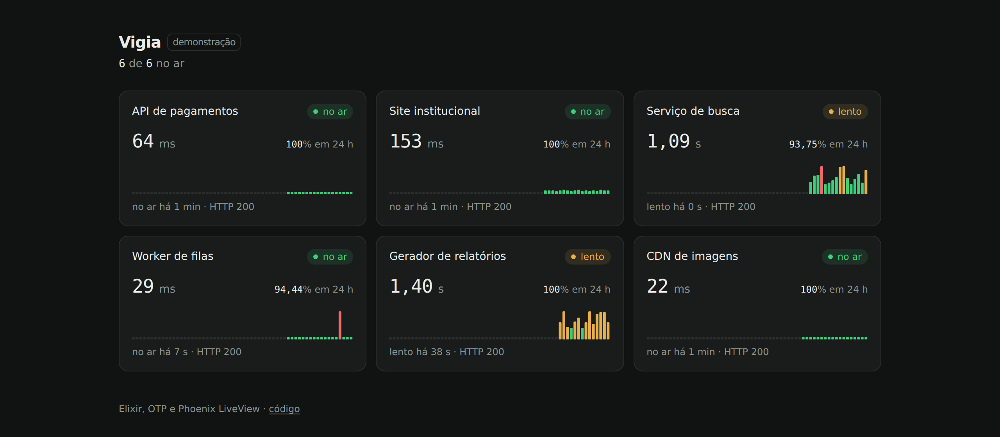

# Vigia

Monitor de serviços em tempo real, escrito em Elixir com OTP e Phoenix LiveView.

Cada serviço monitorado é um processo próprio. O painel recebe cada leitura pelo WebSocket do LiveView e redesenha só o cartão que mudou. Não tem banco de dados, framework JavaScript nem biblioteca de gráficos: o histórico fica em ETS e a linha do tempo é SVG gerado no servidor.



Sem login, o painel mostra serviços fictícios simulados. Com login, mostra os serviços reais configurados por variável de ambiente.

## Arquitetura

```
Vigia.Supervisor (one_for_one)
├── Phoenix.PubSub
├── Vigia.Acesso.Limite      tentativas de login por IP, em ETS
├── Vigia.Tailscale          token OAuth e lista de aparelhos em cache
├── Vigia.Monitor (rest_for_one)
│   ├── Registry             acha o verificador pelo id do alvo
│   ├── Vigia.Historico      dono das tabelas ETS e da limpeza de 24 h
│   ├── DynamicSupervisor
│   │   └── Vigia.Verificador, um por alvo
│   └── Task                 inicia os verificadores na subida
└── VigiaWeb.Endpoint
```

O caminho de uma leitura:

1. O `Verificador` acorda no intervalo do alvo, chama a sonda e mede o tempo com `System.monotonic_time/0`.
2. Grava a leitura direto no ETS. O `Historico` só é dono da tabela: ninguém espera por ele.
3. Publica `{:leitura, leitura}` no tópico do espaço (`monitor:real` ou `monitor:demo`).
4. Cada painel aberto recebe a mensagem, monta o resumo daquele alvo com leituras no ETS e faz `stream_insert` de um cartão.

Se o `Historico` cair, a estratégia `rest_for_one` reinicia o que vem depois dele, e a `Task` sobe os verificadores de novo. Se uma sonda levantar exceção, a leitura vira `fora` em vez de derrubar o processo: para um monitor, uma sonda quebrada é um alvo com problema.

## Decisões de desempenho

- **ETS em vez de banco.** `ordered_set` com chave `{alvo_id, timestamp}` deixa as leituras de cada alvo contíguas, e uma busca com o id fixo percorre só esse trecho. As últimas 60 saem com um `select_reverse` limitado. A disponibilidade sai de dois `select_count`, que contam dentro da tabela sem copiar linhas.
- **Escrita sem gargalo.** Cada verificador escreve na tabela pública com `write_concurrency`. Não passa nenhuma mensagem por um processo central.
- **Lista de alvos em `:persistent_term`.** Muda só na subida e é lida a cada leitura recebida pelo painel. A leitura é de custo constante e não copia a lista.
- **Streams no LiveView.** O servidor não guarda os cartões depois do primeiro render. Cada leitura envia só o HTML do cartão afetado.
- **Cache da API do Tailscale.** Um processo serializa as chamadas, então várias sondas ao mesmo tempo resultam em um token e uma ida à API. Isso tem teste.
- **Sem JavaScript próprio.** O `app.js` só conecta o LiveView.

## Segurança

- Nenhum endereço, hostname ou credencial fica no repositório. Tudo vem de variável de ambiente, e o CI roda o gitleaks a cada push.
- A senha é guardada só como hash PBKDF2-SHA256 com 600 mil iterações, usando apenas `:crypto` do OTP. A comparação é em tempo constante.
- O login aceita cinco tentativas por IP a cada 15 minutos. O contador usa `:ets.update_counter`, que é atômico.
- A sessão fica em cookie cifrado, `http_only` e `secure`. A marca da sessão é derivada do hash da senha, então trocar a senha encerra todas as sessões.
- Para os aparelhos da tailnet, o Vigia não entra na rede: consulta a API do Tailscale com um cliente OAuth só de leitura.

## Rodando localmente

Requer Erlang 29 e Elixir 1.20 (versões em `.tool-versions`).

```sh
mix setup
mix phx.server
```

Abra `http://localhost:4000`. Para ver alvos reais em dev:

```sh
export VIGIA_ALVOS="$(cat alvos.example.json)"
export VIGIA_SENHA_HASH='<saída de mix vigia.senha>'
mix phx.server
```

Verificações do CI:

```sh
mix format --check-formatted
mix compile --warnings-as-errors
mix credo --strict
mix test
mix dialyzer
```

## Configuração

| Variável | Uso |
|---|---|
| `SECRET_KEY_BASE` | Assina e cifra o cookie. Gere com `mix phx.gen.secret`. |
| `PHX_HOST` | Domínio público, usado nas URLs e na checagem de origem do WebSocket. |
| `VIGIA_SENHA_HASH` | Hash da senha do painel. Gere com `mix vigia.senha`. Sem ele, só a demonstração fica disponível. |
| `VIGIA_ALVOS` | Lista JSON de alvos. Modelo em `alvos.example.json`. |
| `TAILSCALE_OAUTH_ID`, `TAILSCALE_OAUTH_SEGREDO` | Cliente OAuth com leitura de `devices:core`, para alvos `tailscale`. |
| `TAILSCALE_TOKEN` | Alternativa ao OAuth. Expira em até 90 dias. |

Campos de um alvo:

| Campo | Tipo | Padrão |
|---|---|---|
| `id`, `nome` | texto, obrigatório | |
| `tipo` | `http` ou `tailscale` | |
| `url` | para `http`; 2xx e 3xx contam como no ar | |
| `dispositivo` | para `tailscale`; hostname ou início do nome MagicDNS | |
| `intervalo` | segundos entre verificações | 30 |
| `tempo_limite` | segundos até desistir | 5 |
| `lento_ms` | acima disso, a leitura fica `lento` | 1500 |

## Deploy

Roda como release no plano gratuito do [Gigalixir](https://gigalixir.com). O buildpack lê `.tool-versions` e executa `mix assets.deploy`.

```sh
gigalixir create -n <nome>
gigalixir config:set SECRET_KEY_BASE="$(mix phx.gen.secret)" PHX_HOST=<nome>.gigalixirapp.com
gigalixir config:set VIGIA_SENHA_HASH='<hash>' VIGIA_ALVOS="$(cat alvos.json)"
git push gigalixir main
```

A rota `/saude` responde `ok` e serve para checagens externas.
